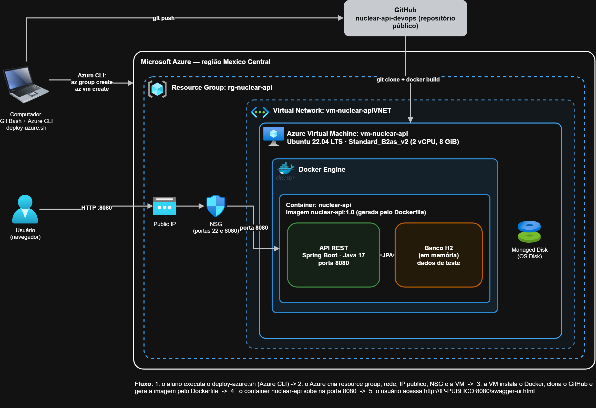

# Nuclear no Dia a Dia — API em Docker na nuvem Azure

**Challenge FIAP 2026 · Parceiro: CTMSP (Centro Tecnológico da Marinha em São Paulo)**
**Disciplina:** DevOps Tools & Cloud Computing · **Entrega:** 1º Sprint

Prova de conceito que demonstra como **Docker** e **Cloud Computing (Microsoft Azure)** podem ser aplicados à solução educativa sobre tecnologia nuclear proposta pelo grupo. A API REST da solução é empacotada em um container Docker e executada em uma **VM no Azure**, provisionada inteiramente pelo **Azure CLI**.

## Integrantes

| Nome | RM | Turma |
|------|----|-------|
| Mariana de Paula Aguiar | RM566850 | 2TDSPB |
| Gustavo Miguel Martins de Oliveira | RM566666 | 2TDSPB |
| Manuella Moraes Rodrigues Rinaldi | RM567915 | 2TDSPS |

## Links da entrega

- **Vídeo de demonstração (YouTube, não listado):** `COLE_AQUI_O_LINK_DO_VIDEO`
- **Repositório:** https://github.com/marianaaguiar27/nuclear-api-devops

## A solução

A **Nuclear no Dia a Dia** é uma solução digital que aproxima a sociedade da tecnologia nuclear mostrando, de forma simples e educativa, onde ela aparece no cotidiano: saúde, indústria, agricultura, pesquisa científica e geração de energia. O aplicativo mobile e o quiz do projeto consomem os conteúdos (curiosidades) fornecidos por esta API.

A API (Java 17 + Spring Boot) oferece CRUD de conteúdos, filtro por categoria, busca por texto e documentação Swagger. Nesta entrega ela usa o banco **H2 em memória**, já com dados de teste carregados automaticamente. O perfil `oracle` da aplicação fica reservado para as próximas sprints.

## Arquitetura



O arquivo editável do diagrama está em [`docs/arquitetura.drawio`](docs/arquitetura.drawio).

| Componente | Função |
|------------|--------|
| **Azure CLI** (máquina do aluno) | Provisiona toda a infraestrutura por linha de comando |
| **Resource Group** `rg-nuclear-api` | Agrupa os recursos; ao ser apagado, remove tudo de uma vez |
| **Virtual Machine** `vm-nuclear-api` | Ubuntu 22.04 LTS, tamanho `Standard_B2as_v2` (2 vCPU, 8 GiB), região Mexico Central |
| **Public IP + NSG** | IP público e firewall liberando a porta 22 (SSH) e a 8080 (API) |
| **Docker Engine** | Instalado na VM; executa o container da aplicação |
| **Container `nuclear-api`** | API Spring Boot (Java 17) na porta 8080, com banco H2 em memória |
| **GitHub** | Guarda o código; a VM faz `git clone` e gera a imagem pelo Dockerfile |

**Comunicação:** o usuário acessa `http://IP-PÚBLICO:8080` → Public IP → NSG (porta 8080) → container `nuclear-api` dentro da VM.

## Estrutura do repositório

```
.
├── Dockerfile            # Imagem da API (build em duas etapas)
├── .dockerignore
├── deploy-azure.sh       # Cria RG + VM, instala Docker e sobe o container
├── setup-vm.sh           # Executado DENTRO da VM pelo deploy-azure.sh
├── cleanup-azure.sh      # Apaga o Resource Group e comprova a exclusão
├── docs/
│   ├── arquitetura.png
│   └── arquitetura.drawio
├── build.gradle, gradlew, settings.gradle
└── src/                  # Código-fonte da API (Java + Spring Boot)
```

## Dockerfile

O [`Dockerfile`](Dockerfile) usa **build em duas etapas**:

1. **Etapa `build`** (`eclipse-temurin:17-jdk`): copia os arquivos do Gradle e o código, e gera o `.jar` com `./gradlew bootJar`.
2. **Etapa final** (`eclipse-temurin:17-jre`): copia apenas o `.jar` para uma imagem enxuta (somente JRE), roda com um usuário sem privilégios, expõe a porta `8080` e inicia com `java -jar app.jar`.

### Executando localmente (apenas para testar a imagem)

Requisito: Docker Desktop.

```bash
docker build -t nuclear-api:1.0 .
docker run -d --name nuclear-api -p 8080:8080 nuclear-api:1.0
docker ps
docker logs nuclear-api
```

Testes: `http://localhost:8080/api/conteudos` e `http://localhost:8080/swagger-ui.html`.

```bash
docker rm -f nuclear-api   # para e remove o container
```

> Na entrega, o container é executado **na VM do Azure**, e não apenas em localhost.

## Azure CLI — comandos utilizados

Todos os comandos abaixo estão automatizados em [`deploy-azure.sh`](deploy-azure.sh).

```bash
# 1. Login e conferência da assinatura
az login
az account show --output table

# 2. Grupo de recursos
az group create --name rg-nuclear-api --location mexicocentral

# 3. Criação da VM
az vm create \
  --resource-group rg-nuclear-api \
  --name vm-nuclear-api \
  --image Ubuntu2204 \
  --size Standard_B2as_v2 \
  --admin-username azureuser \
  --generate-ssh-keys \
  --public-ip-sku Standard

# 4. Liberar a porta da API no firewall (NSG)
az vm open-port --resource-group rg-nuclear-api --name vm-nuclear-api --port 8080 --priority 1010

# 5. Instalar Docker na VM, clonar o repositório, gerar a imagem e subir o container
#    (executa o setup-vm.sh dentro da VM)
az vm run-command invoke \
  --resource-group rg-nuclear-api \
  --name vm-nuclear-api \
  --command-id RunShellScript \
  --scripts @setup-vm.tmp.sh

# 6. Comprovar o provisionamento
az vm show --show-details --resource-group rg-nuclear-api --name vm-nuclear-api --output table
az resource list --resource-group rg-nuclear-api --output table

# 7. Exclusão dos recursos (cleanup-azure.sh)
az group delete --name rg-nuclear-api --yes
az group exists --name rg-nuclear-api      # deve retornar: false
```

> **Observação:** o tamanho `Standard_B2s` estava sem capacidade na região Mexico Central no momento dos testes (erro `SkuNotAvailable`), por isso a VM usa o `Standard_B2as_v2`.

## Como executar

**Requisitos:** conta no Azure (login feito com `az login`), Azure CLI e Git Bash (ou qualquer terminal bash).

```bash
git clone https://github.com/marianaaguiar27/nuclear-api-devops.git
cd nuclear-api-devops

# Cria a VM, instala o Docker, sobe o container e testa a API pela internet
./deploy-azure.sh https://github.com/marianaaguiar27/nuclear-api-devops.git
```

Parâmetros opcionais: `./deploy-azure.sh <URL_DO_REPO> [TAMANHO_DA_VM] [REGIÃO] [ZONA]`.

Ao final, o script imprime o IP público e as URLs:

- API: `http://IP-PÚBLICO:8080/api/conteudos`
- Swagger: `http://IP-PÚBLICO:8080/swagger-ui.html`

### Apagando os recursos

```bash
./cleanup-azure.sh
```

O script apaga o Resource Group (VM, disco, IP, rede e NSG) e mostra `false` em `az group exists`, comprovando a exclusão. Isso evita consumo de créditos.

## Como Docker e Cloud Computing podem ser utilizados na solução proposta pelo grupo?

A solução **Nuclear no Dia a Dia** precisa chegar a um público amplo — estudantes, escolas, museus e visitantes — por meio de um aplicativo mobile e de um quiz que consomem os conteúdos de uma API. Para isso, essa API precisa estar sempre disponível e acessível pela internet, e é aí que a **Cloud Computing** entra: ao publicar a aplicação em uma VM no Azure, ela deixa de depender do computador de um integrante do grupo e passa a ter IP público, disponibilidade e infraestrutura gerenciada, paga apenas pelo tempo de uso. Se o número de acessos crescer, por exemplo durante uma campanha ou um evento com a Marinha, a nuvem permite aumentar os recursos ou evoluir para serviços gerenciados, como o Azure Container Apps, sem mudar a aplicação.

O **Docker** resolve o problema de levar a aplicação de um ambiente para outro. A imagem contém a API e tudo de que ela precisa (Java 17 e as dependências), de modo que o mesmo container que roda no computador do desenvolvedor roda igual na VM do Azure, sem instalar Java ou configurar o ambiente manualmente. Isso torna a implantação rápida, repetível e fácil de automatizar, como demonstrado pelo `deploy-azure.sh`, que cria a infraestrutura e coloca a API no ar em poucos minutos. Nas próximas sprints, a mesma imagem poderá ser conectada a um banco Oracle e integrada a um pipeline de CI/CD, mantendo uma entrega consistente do desenvolvimento até a nuvem.

## Tecnologias

Java 17 · Spring Boot 4.1 · Gradle · Spring Data JPA · H2 · Swagger/OpenAPI · Docker · Microsoft Azure (VM, Resource Group, NSG, Public IP) · Azure CLI · GitHub
